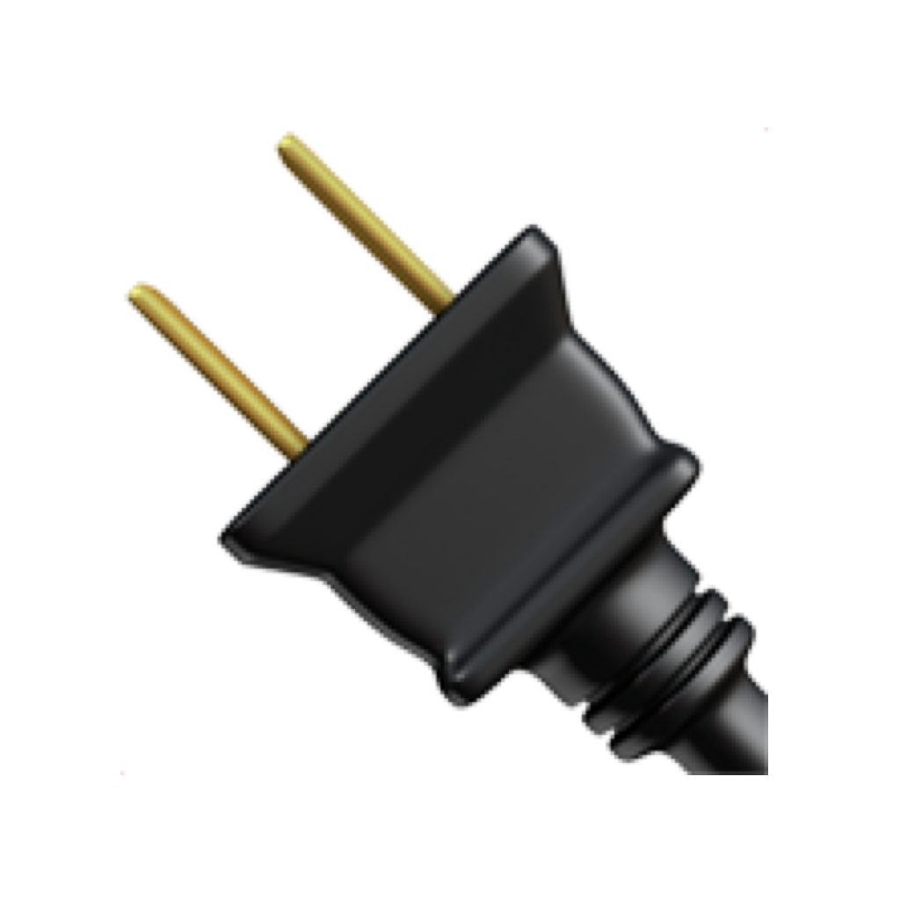

#  UsbTether

A trimmed fork of [rtether](https://github.com/nkazbekov/rtether) (MIT OR Apache-2.0): a macOS userspace RNDIS USB-tethering daemon (`usbtetherd`). It also builds on the ideas of erg-tether. Unlike upstream it only connects phones on an approved-phone allowlist: an unknown phone is not touched until an admin approves it over a local control socket (`/var/run/usbtether.sock`), and an approval app is launched for the console user when one is waiting.

## What it is

macOS has no driver for RNDIS, the protocol Android phones (Samsung in particular) use for USB tethering. `usbtetherd` is a root launch daemon that speaks RNDIS from userspace and moves the phone's traffic over a `utun` interface. `UsbTether.app` is the small approval app: it asks before a new phone is used and lists the approved phones.

## Install

```sh
brew tap PhilRoli/tap
brew install --cask usbtether
```

The install asks for your administrator password once, to install the background service (`usbtetherd`, a root launch daemon).

The app must be at `/Applications/UsbTether.app`: the daemon launches it from there, so after an `--appdir` install the approval popup never appears (the daemon only logs the waiting phone).

## First phone

Plug the phone in and turn on USB tethering. A popup asks whether to approve it:

- **Approve**: the phone is added to the allowlist and tethering starts. From then on it connects whenever it is plugged in with tethering on.
- **Not now** (or closing the window while the prompt is shown): the phone is not asked about again until it is unplugged and plugged back in. Logging out, restarting or shutting down does not count as "Not now".

Phones that do not report a serial number are approved by their USB vendor and product ID alone; the popup says so.

## Removing phones

Open UsbTether.app and remove the phone from the list. A phone that is tethering right now is disconnected.

## Uninstall

```sh
brew uninstall --cask usbtether
```

This stops and removes the daemon. `brew uninstall --zap --cask usbtether` also removes the approved phones and the logs.

## Security model

The allowlist decides which phones are used; it is not authentication.

- A phone is identified by its USB vendor ID, product ID and serial number, all reported by the device itself. A device that clones an approved phone's USB identity is accepted.
- Phones without a serial number share one ID per model: approving one approves every device with the same vendor and product ID.
- Any process running as a member of the `admin` group (or as root) can approve a pending phone over the control socket without anyone clicking Approve.
- During `brew install` the installer runs a script from the app bundle as root. The bundle sits in a user-writable location, so a process running as the same user could race to modify it in that short window. The installer refuses symlinked or group/world-writable files and verifies the copy it installs, but closing this fully would need Developer ID signing or a root-owned installer package.
- Builds are ad-hoc signed and not notarized. The installer removes the quarantine flag from the installed daemon and from the app, so Gatekeeper does not block them after a checksum-verified `brew install`.

## Releasing

Push a `vX.Y.Z` tag on a commit that is already on `main` (the workflow refuses any other): the Release workflow tests, packages a universal build, publishes the GitHub release and updates the Homebrew cask in `PhilRoli/homebrew-tap`. Prerelease tags such as `v1.2.0-rc.1` publish a GitHub prerelease but skip the tap.

- The `HOMEBREW_TAP_TOKEN` secret is a fine-grained personal access token with Contents write access to the tap repository.
- Running the workflow by hand (`workflow_dispatch`) is a dry run only: it builds and packages, and never releases or touches the tap.
- The repository setting "Allow auto-merge" must be enabled for Dependabot's auto-merge, and branch protection should require the `ci` check.
- Dependency bumps auto-merged by Dependabot ship with the next manual tag. Review `git diff <last tag>..HEAD -- Cargo.lock` before tagging.
- A dispatch dry run queued behind a pending tag run can cancel it; if that happens, re-run the tag's workflow.

## License

MIT OR Apache-2.0, see `LICENSE-MIT` and `LICENSE-APACHE`.
